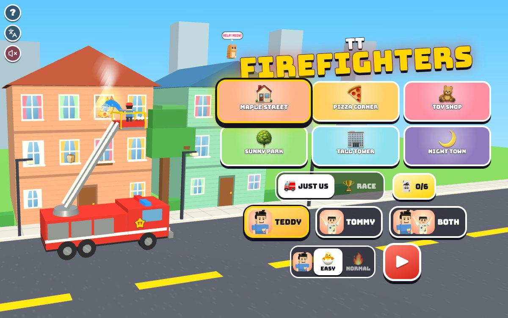

# TT Firefighters

Press **?** any time (or tap the round **?** button in the top left corner) to see the keys. The game waits while you look.
Tap the language button under it (the A文 icon) to switch between English and 中文; the dashboard and every game remember the choice.

**中文：** 消防员：开着消防车，升高梯子，喷水灭掉会做鬼脸的火，把小猫从窗口、屋顶和大树上救下来。每条街灭完火都能拿到一张安全卡片。可以自己灭火，也可以和狐狸、青蛙比赛，或者兄弟俩一起开两辆消防车。

A firefighting game for Teddy and Tommy. Drive the fire truck along the street, raise the ladder until the basket is right in front of a fire, and hold the water: the silly fires (they have googly eyes, and pull a face when the water hits them) shrink and go out with a PSSSH! Bring the basket close to a kitten and it hops in, rides the basket and slides down the ladder onto the truck. Every street you finish gives you a **safety tip card**. Six streets, two levels, 1 or 2 players, a race against Foxy 🦊 and Froggy 🐸, and the other brother always ready to hop on the truck and spray the big fire.

It's built with Claude Code from plain JavaScript and Three.js, in the same style as Metro Surfer and the other Teddy & Tommy games. There are no image, model or audio files: the buildings' fronts, the flame faces and the kittens are boxes and canvas drawings, Teddy and Tommy come from the shared kit (`kit/`), and every sound is synthesised.

The name lives in one place, [js/title.js](js/title.js).

## Play

- **Double-click `index.html`.** It works offline, because Three.js and the kit are copied into `kit/`. Without internet the logo falls back from the Bungee font to Arial Black.
- **Send one file:** `dist/firefighter-tt.html` is the whole game in one file. AirDrop or email it, then open it in a browser.
- **Rebuild that file** after any edit: `python3 kit/tools/bundle.py . --name firefighter-tt`
- **Get kit updates** from `~/claude-games/kit`: `python3 ../kit/tools/sync.py .`, then rebuild.
- **On the home screen** pick a street, 🚒 JUST US or 🏆 RACE, who drives (TEDDY, TOMMY or BOTH), 🐣 EASY or 🔥 NORMAL for each brother, then ▶. Behind the menu a fire truck does the chosen street, again and again.
- **Each street** starts with the siren and 3, 2, 1, GO! The top right shows how many fires 🔥 and kittens 🐱 are left, and the clock.
- **The end:** when every fire is out and every kitten is safe, ALL SAFE! The winner does his signature move in his basket (Teddy's boxing combo, then his 🏀 jump shot; Tommy's Y with peace fingers ✌️) while confetti flies, then the results: everyone's fires and kittens and points, the time, a time bonus, NEW BEST! when you beat your best, and the street's safety card. 🔁 plays again, ⏭️ goes to the next street, 🏠 back home.
- **Saved per browser:** the street, the mode, who drives, each brother's level, the best score on every street (for each mode, players and levels), the safety cards you've got, and each brother's 🏆 race wins. `index.html` and `dist/firefighter-tt.html` each keep their own, because they're different ways of opening the game.

### The streets

| Street | Buildings | Fires | Kittens | The big fire |
|---|---|---|---|---|
| 🏠 Maple Street | 2 houses | 3 (the toast, a pile of socks) | 1 on a roof | top floor |
| 🍕 Pizza Corner | pizza shop, flats, bakery | 4 (the pizza, the toast) | 2 (one waits behind a fire) | the flats |
| 🧸 Toy Shop | 3 | 5 (books, a present, cookies) | 2 (one behind a fire) | top of the toy shop |
| 🌳 Sunny Park | ice cream shop, 3 trees, a house | 4 (a hot dog, the barbecue) | 3 (two up trees) | the treehouse |
| 🏢 Tall Tower | a 6-floor tower and 2 more | 6 (toast, socks, a birthday cake) | 2 (one on the tower's roof) | the tower's top floor |
| 🌙 Night Town | 3, at night with the lights on | 7 | 3 | the middle house |

Every street has one big fire (bigger, cheekier, and it takes longer). The streets are in [js/levels.js](js/levels.js).

### Firefighting

- **Drive** left and right along the street. **The ladder** goes up and down; the basket is always just in front of the cab.
- **Water:** hold the water button and the stream goes straight into the building in front of the basket. A fire shrinks while it's wet and goes out: **PSSSH! +100**, the big one **BIG FIRE OUT! +300**.
- **Kittens:** bring the basket close and the kitten hops in (**🐱 KITTEN SAVED! +200**), slides down the ladder and sits on top of your truck. A kitten in a window that's on fire says **TOO HOT! SPRAY THE FIRE FIRST!**
- **The water tank (🔥 NORMAL):** the 💧 bar by your score runs down while you spray. Stop at the red fire hydrant on the sidewalk to fill up (**💧 FILLING UP!**).
- **Time bonus:** finish sooner than the street's par time for extra points.

### Safety cards

One for each street, shown on the results and kept in the 🃏 book on the home screen (C):

| | Card |
|---|---|
| 🛑 | Stop, drop and roll: if your clothes catch fire, stop, drop to the ground and roll. |
| 🔥 | Hot things are for grown-ups: matches, lighters and stoves are for grown-ups only. |
| 🔔 | Beep beep? Get out! When the smoke alarm beeps, go outside fast and stay out. |
| 🌳 | Pick a meeting spot: a place outside, like a big tree, where your family meets. |
| 🐾 | Get low and go: smoke goes up, so crawl low under it to the door. |
| 📞 | Get out, then call 911: go outside first, then a grown-up calls 911. |

### Just us and the race

- **🚒 JUST US:** one truck, or with BOTH two trucks (Teddy's and Tommy's) on the same street, working together. Points for everyone, one team score.
- **🏆 RACE:** Foxy 🦊 drives a lime-green fire truck with Froggy 🐸 hanging on at the back. Whoever puts out more fires and saves more kittens wins. With BOTH, both brothers race them.

### Levels

| | 🐣 EASY (Tommy, 5) | 🔥 NORMAL (Teddy, 8) |
|---|---|---|
| Aiming | wide: near enough is good enough | the basket has to be right in front of the fire |
| Lining up | let go and the basket glides to the nearest fire or kitten | stays where you put it |
| Water | never runs out | a tank you fill at the hydrant |
| Fires | stay as small as you left them | grow back if you stop spraying |
| Foxy and Froggy | they take breaks to wave at the crowd | a real race |

With BOTH, each brother picks his own level; fires only grow back when both are on NORMAL.

## Controls

| | 1 player | Teddy (2 players) | Tommy (2 players) |
|---|---|---|---|
| Drive | A D or ← → | A D | ← → |
| Ladder up / down | W S or ↑ ↓ | W S | ↑ ↓ |
| Spray water (hold) | Space, Enter or F | Space or F | Enter |
| Call your brother · high five | T | T | T |
| Pause | P or Esc | | |
| Sound on / off | M | | |

- **Home screen:** A D or ← → pick a street, W S or ↑ ↓ pick the level (with BOTH, W S for Teddy, ↑ ↓ for Tommy), 1 2 3 pick who drives, R switches just us / race, C opens the safety cards, Enter or Space starts. On the results, Enter plays again, N goes to the next street, Esc or H goes home.
- **Touch:** each brother has a ◀ ▶ ▲ ▼ pad (drive and ladder) and a big 💧 button (hold to spray), Teddy's on the left and Tommy's on the right. Tap your brother's face (or ✋ with two players) at the bottom.
- **The ? panel, the language button and the speaker** sit in a column in the top left corner, in the sky above the street, away from the pads.

## Companion

- **Call your brother any time, as often as you like:** press T or tap his face at the bottom of the screen (Kit.roster.buddyFor picks him: Tommy for Teddy, Teddy for Tommy).
- He pops up on top of your fire truck, at his buddy size, faces you and does his signature move: Tommy's Y ✌️, or Teddy's boxing and 🏀 jump shot.
- He tosses a treat up to your basket (🍦 💧 🧃 🍪 🍉 🍌): "🍪 COOKIE FROM TOMMY!"
- Then his helper: **"TOMMY SAYS: I'LL GET THE BIG FIRE!"** He turns to the big fire, wherever it is on the street, and sprays it with his own big hose until it's out. Call him again and he sprays the biggest fire still burning; with every fire out he sprays a water rainbow 🌈. Then he waves and pops off. Call him again whenever you like.
- **With two players,** T (or the ✋ button) is a high five: both brothers hold out a hand and both water tanks fill up.

## How it was checked

- **`node tools/check.js`** (about 3 seconds), the same checks as `game.check()` in the page ([js/checks.js](js/checks.js)). Whole streets are played by pretend firefighters (a careful one, a wobbly 5-year-old, an 8-year-old, one mashing every button, one who just holds ▲) on the real rules ([js/rules.js](js/rules.js)):
  - **reach:** every fire can be sprayed and every kitten reached from the road on both levels (84 of them on 6 streets), each street has exactly one big fire, every kitten that waits behind a fire waits behind a real fire in its own window, and the hydrant is on the road.
  - **win** (every street can be won): every street at both levels, 1 player, 2 players, against Foxy and Froggy, and both brothers against them, played to the end by a careful firefighter (the slowest 27 s); a wobbly 5-year-old wins every street on EASY (at most 66 s) and on NORMAL (at most 573 s), and an 8-year-old wins every street on NORMAL (at most 166 s). 102 games, all won.
  - **stuck** (no stuck states): 108 games mashed at random for 12, 20 or 40 seconds (ladder all the way up, tank empty, half the fires out), with nothing going off the road, no broken numbers and nothing coming undone; then a careful player takes over from wherever it was left, and every one of them finishes.
  - **buddy:** on every street and level, each call of the brother puts out the fire he aims at, the big one first, until every fire is out; called with nothing left, he aims at nothing.
  - **frames:** the same game at 30, 60 and 144 frames a second and at a jumpy frame rate comes out exactly the same (fixed 1/120 s steps).
  - **easyRace:** on EASY the wobbly 5-year-old beats Foxy and Froggy in 11 of 12 races.
  - **Each check is broken on purpose** and has to notice: the tower's big fire floating out of reach (caught by reach and win), a kitten waiting behind a fire that isn't there (reach and win), a hydrant with no water (win), a ladder that won't come back down from high up (stuck), the brother's hose spraying nothing (buddy), one physics step per frame (frames), and Foxy and Froggy going all out on EASY (easyRace). All nine are caught.
- **In the browser** (muted): every street, both levels, 1 player and 2, the race, keys and touch buttons (synthetic pointer events), the brother's visit (treat, big hose, water rainbow), high fives, the empty tank and the hydrant, pause, M, the ? panel, the card book, the end of the street and the results, through `game.step()`. 中文: every screen visited with `Kit.lang.untranslated()` returning [], and the toasts read one by one. English: no Chinese on the page except the kit's language button. No console errors. `index.html` and `dist/firefighter-tt.html` both open from `file://` in headless Chrome and play to the results with no page errors.
- **Layouts** in headless Chrome (`node tools/shoot.js tools/shots-layout.json <dir> <width> <height> <mobile>`): phone portrait 390x844, phone landscape 740x360, iPad 1024x768 and 820x1180. `docs/screenshot.jpg` is the title screen at 1200x750 (`node tools/shoot.js tools/shots.json docs 1200 750`).

## Files

- [index.html](index.html): the page, its styles and the menus.
- [js/title.js](js/title.js): the name.
- [js/levels.js](js/levels.js): the six streets (buildings, trees, fires, kittens, the hydrant) and the safety cards.
- [js/rules.js](js/rules.js): the rules with no drawing: driving, the ladder, the water and the tank, fires and kittens, the brother's big hose, scores, Foxy and Froggy, the pretend players.
- [js/checks.js](js/checks.js), [tools/check.js](tools/check.js): the headless checks.
- [js/world.js](js/world.js): the 3D street: sky, road, buildings and their fronts, trees, the hydrant, the flame faces, kittens, water, smoke, steam and hearts.
- [js/truck.js](js/truck.js): the fire trucks, the ladder and basket, the firefighters in their helmets (the kit's boys, Foxy and Froggy).
- [js/game.js](js/game.js): the game: home, count-in, controls, camera, the brother's visit, the HUD, results, the card book.
- [js/keys.js](js/keys.js), [js/zh.js](js/zh.js): the ? panel and the 中文 words.
- [tools/shoot.js](tools/shoot.js): screenshots with headless Chrome.

## Not verified

- **Sound:** every test ran muted, so none of it has been heard; the siren, hoses, kitten meows and the rest are checked in code only.
- **Real touch devices:** an iPhone or iPad, iOS Safari, two kids holding pads at once on one iPad, and the frame rate on an older iPad.
- **Real kids:** whether EASY is easy enough for Tommy, whether NORMAL's tank and regrowing fires are fun or annoying for Teddy, and whether the safety cards are read. The cards say 911 (the US number); in China it's 119.
- **The iPad home-screen icon** (🚒 on sky blue) and double-click from Finder.
